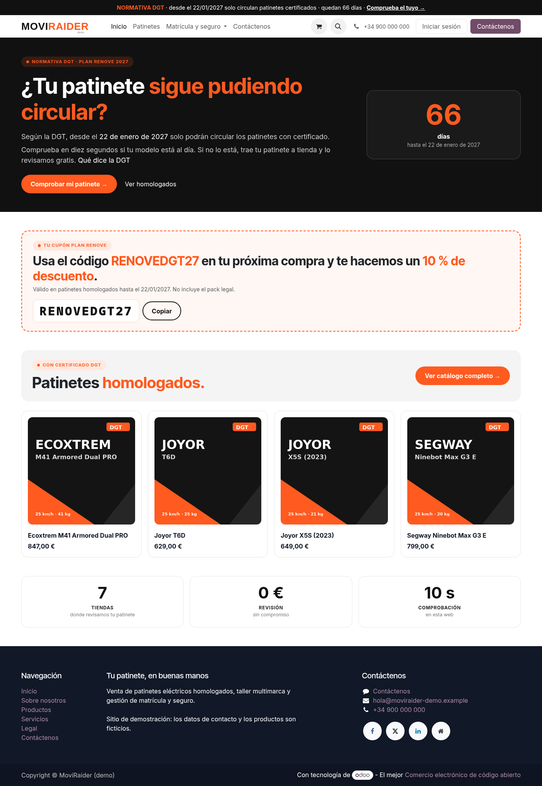
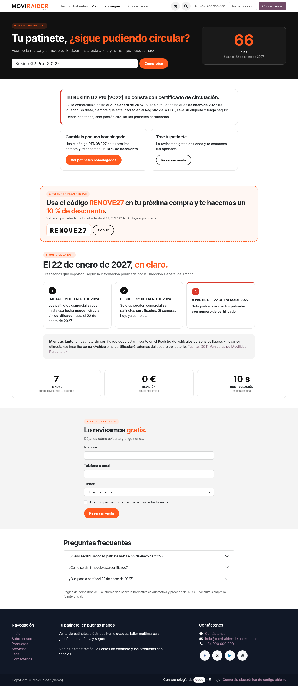
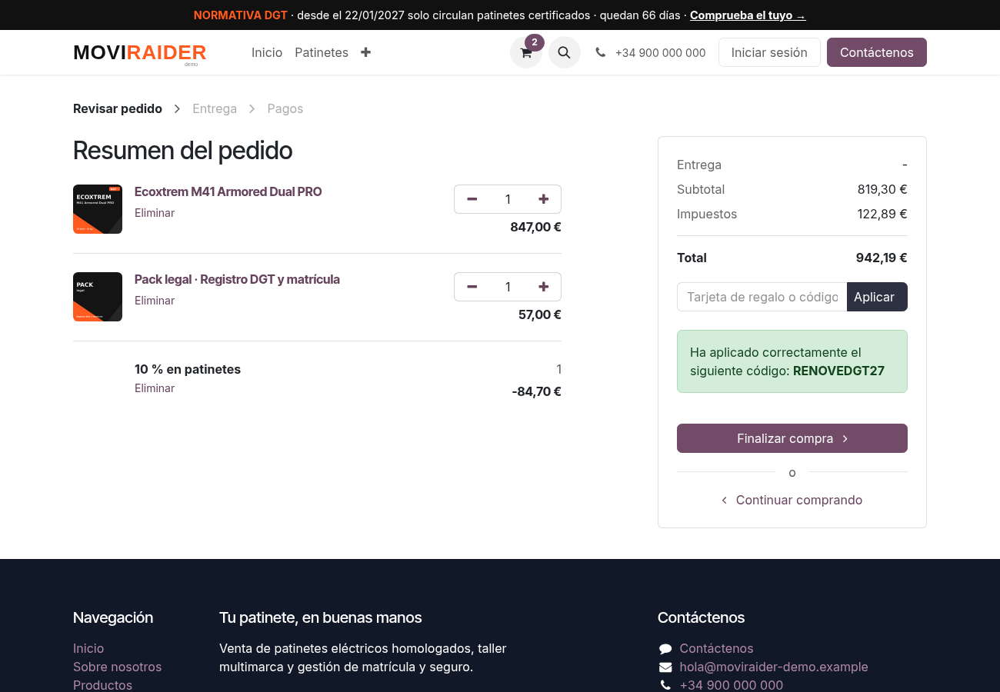
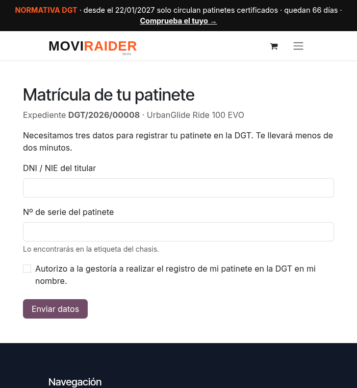
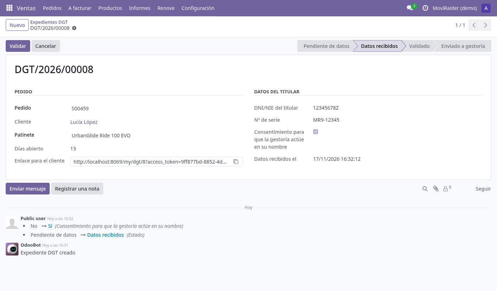
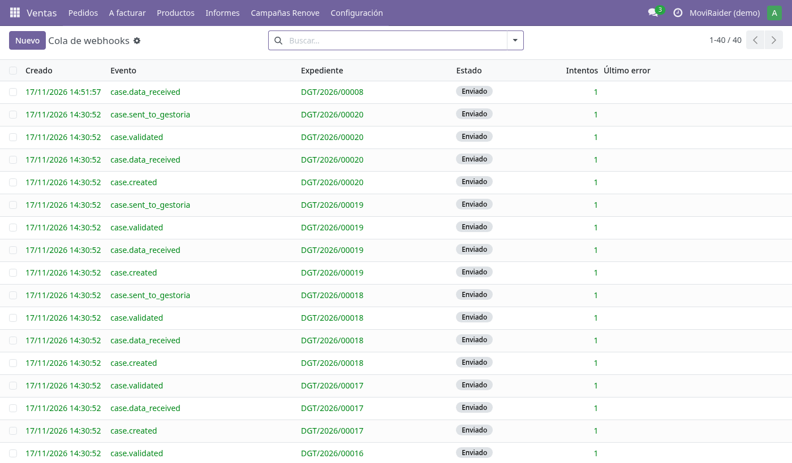
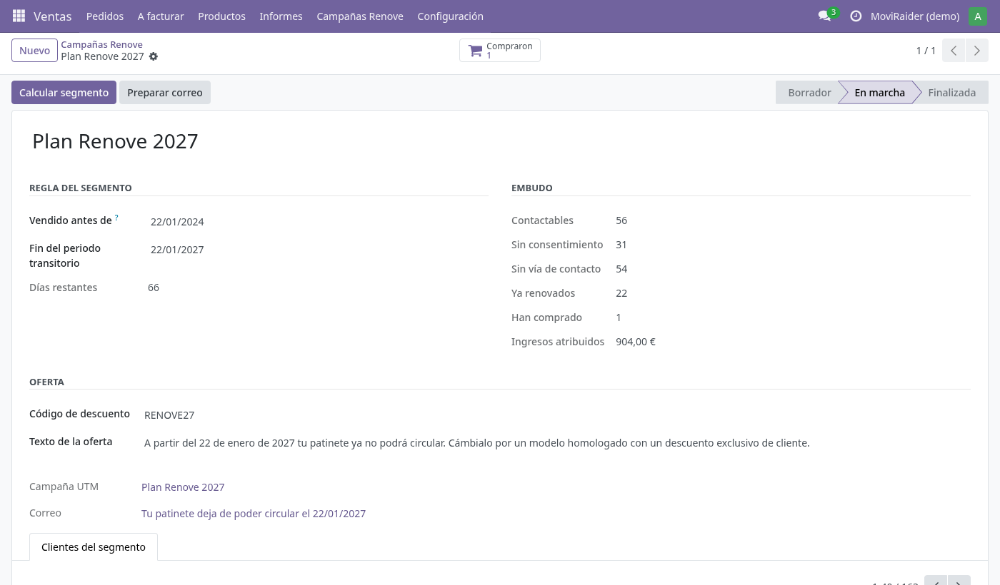
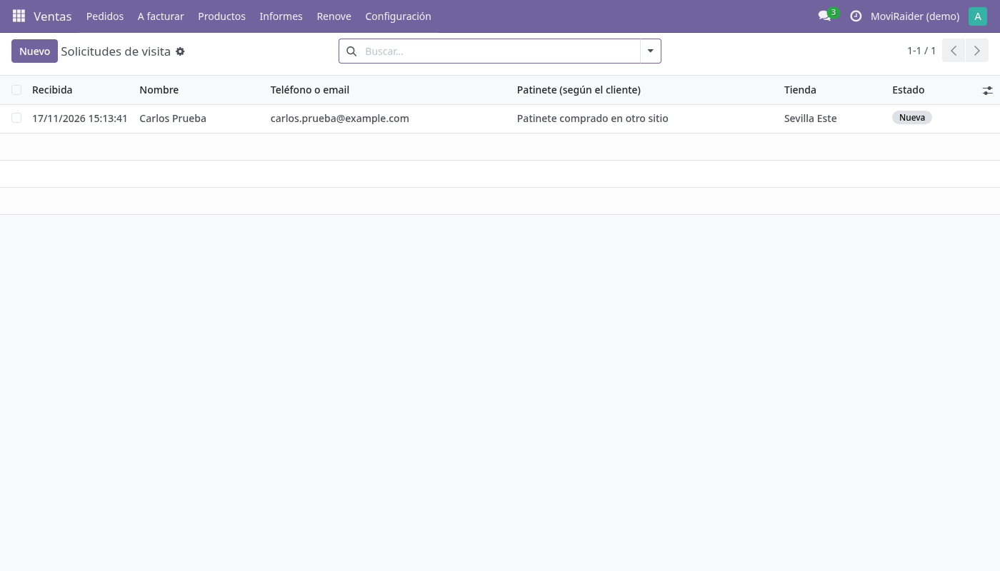

# Plan Renove + Expediente DGT

Demo técnica para el departamento de tecnología de MoviRaider, construida como **módulos de Odoo 18**.

> **Aviso.** Todo corre sobre **datos sintéticos** y **sin acceso a ningún sistema de MoviRaider**. Lo que sé de la empresa procede de sus páginas públicas y de la DGT; el resto son **supuestos**, y están declarados en la sección 5. No está afiliada a MoviRaider ni usa sus logos, imágenes o marca. Nunca se ha lanzado nada contra sus servidores.

## En 30 segundos

- **Fricción 1.** El pack legal (57 €) arranca *después* de entregar el patinete: la propia web dice «cuando lo recibas, te escribimos para pedirte los datos del trámite». Mientras tanto el patinete no puede circular y depende de que alguien escriba.
- **Oportunidad.** El **22 de enero de 2027** termina el periodo transitorio para los patinetes vendidos antes de 2024 sin certificado (DGT). Los clientes que compraron esos patinetes están en su Odoo.
- **Qué hice.** Un expediente DGT que nace con el pedido y avisa al cliente por webhook; una campaña de renovación con cupón real y atribución de ventas; y una web pública con un comprobador («¿mi patinete sigue pudiendo circular?»).
- **Cómo se prueba.** Dos comandos levantan todo con datos de ejemplo (sección 7); 65 pruebas automáticas cubren la lógica.



## 1. El problema, con evidencia

Consultado en sus páginas públicas el 16-17 de noviembre de 2026.

| Observación | Fuente | Estado |
|---|---|---|
| El pack legal se tramita después de recibir el patinete: «primero te llega el patinete, sin matrícula. Cuando lo recibas, te escribimos para pedirte los datos del trámite» | ficha *Pack legal · Registro DGT y matrícula* | **Confirmado** |
| Sin el pack, «el patinete llega sin matrícula ni registro, y así no puede circular» | página de Black Friday | **Confirmado** |
| El plazo de la matrícula aparece como «3-5 días hábiles» en una página y «1-5 días laborables» en otra | Black Friday / *Trámite DGT completo* | **Confirmado** (inconsistencia) |
| El seguro se contrata en un cotizador aparte | `/seguro-patinete-electrico` | **Confirmado** |
| Su web está hecha con Odoo | metadato `generator` de las páginas | **Confirmado** (versión desconocida) |
| El proceso manual cuesta tiempo o ventas | — | **Hipótesis**: no tengo cifras |

**Fecha límite, según la DGT:** «Los VMP comercializados hasta el 21 de enero de 2024 podrán circular hasta el 22 de enero de 2027 aunque no dispongan de certificado. A partir de dicha fecha, solamente lo podrán hacer los VMP que cuenten con la certificación». Mientras tanto deben estar inscritos en el Registro y llevar etiqueta (se inscriben como «Vehículo no certificado»).

## 2. Qué he construido

Tres módulos de Odoo 18. `dgt` y `renove` **no se conocen entre sí**; ambos dependen de un módulo mínimo con los atributos del patinete.

| Módulo | Resuelve | Qué hace |
|---|---|---|
| `moviraider_catalog` | Base compartida | Campos del producto: es patinete, certificado DGT, peso, velocidad |
| `moviraider_dgt` | **El proceso** | Crea un expediente al confirmar un pedido con pack legal; formulario para el cliente (portal con token); estados y validaciones; cola de webhooks hacia la mensajería |
| `moviraider_renove` | **La oportunidad** | Segmenta clientes con patinete antiguo; campaña con correo en borrador, cupón real y embudo; web pública con comprobador y reserva de visita |

```
 Pedido con pack legal ──▶ expediente DGT ──▶ cola de webhooks ──▶ (respond.io)
                                 ▲
 Campaña Renove ──▶ enlace con utm ──▶ carrito + cupón ──▶ pedido atribuido
```

La conexión entre ambos es solo por datos: la campaña marca el pedido con su `utm.campaign` (mecanismo nativo de Odoo) y `dgt` crea el expediente igual que con cualquier pedido, sin saber de dónde vino.

## 3. Recorrido

**El cliente comprueba su patinete.** Escribe el modelo y recibe el veredicto, con la fecha de la DGT y la fuente enlazada.



**El cupón funciona de verdad en el carrito** (promoción nativa de Odoo): −10 % **solo en el patinete**; el pack legal, que es un trámite, no se descuenta. Un código falso o caducado se rechaza.



**Los datos de la matrícula se piden al momento de la compra**, no después de la entrega. El cliente los envía desde el móvil en dos minutos.



**Operaciones ve el expediente avanzar solo**, con el historial de quién cambió qué.



**Cada cambio sale por una cola de webhooks** que muestra el estado de cada entrega y el motivo si falla.



**La campaña mide el embudo**: contactables, huecos de datos, compras atribuidas, ingresos y descuento concedido.



**Quien no está en la base de datos también entra**: reserva una visita para que le revisen el patinete, y la solicitud llega al backoffice ligada a la campaña.



## 4. Decisiones de diseño y su coste

| Decisión | Por qué | Coste / límite |
|---|---|---|
| **Cola de webhooks transaccional** (outbox) en vez de llamar a la mensajería desde la venta | Que WhatsApp falle no puede bloquear una venta. El evento se guarda en la misma transacción que el cambio | La entrega puede tardar **hasta un minuto** (la hace un cron) |
| **`event_id` en cada evento** | La entrega es «al menos una vez»; el receptor debe poder descartar duplicados | Exige receptor idempotente (el simulador lo es) |
| **Módulos independientes** + catálogo compartido | `renove` se desinstala el 23/01/2027 sin tocar `dgt` | Un módulo más |
| **Atribución con `utm.campaign` nativo** | Cero código propio; el pedido web hereda la campaña desde el enlace | Atribuye por **enlace**, no por persona |
| **Cupón con `sale_loyalty`** | Cupón real, con fecha de fin ligada a la campaña | Dependencia de un módulo más |
| **Segmentar por fecha de venta** | Simple y explicable | Es un *proxy*: puede haber falsos positivos |
| **Portal con token no adivinable** | Que nadie vea el expediente de otro cambiando un número en la URL | — |

## 5. Supuestos y cómo los validaría

Esta es la parte que más importa: **no sé cómo funcionan sus sistemas por dentro.**

| Supuesto | Cómo lo validaría | Si es falso |
|---|---|---|
| Producción usa **Odoo 18** (en el mercado se piden v16–v18) | Preguntar por la versión | Revisar vistas y APIs; la lógica de negocio se conserva |
| «Vendido antes del 22/01/2024» ⇒ «sin certificado» | Cruzar cada modelo con el listado oficial de modelos certificados de la DGT | Falsos positivos en la campaña |
| El histórico tiene **email y consentimiento** suficientes | Medirlo en su base. En la demo son el 34 % del segmento (56 de 163); es un dato **inventado** | La campaña depende más de la web pública y de las tiendas |
| La gestoría **no tiene API** | Preguntar si hay vía digital | Hoy el expediente llega «completo y listo para presentar», no presentado |
| La DGT pide DNI/NIE, nº de serie y consentimiento | Confirmarlo con la gestoría | Cambian los campos del formulario |
| **«Trae tu patinete / revisión gratis»** es una propuesta mía | Validarlo con negocio: no consta que MoviRaider lo ofrezca | Se quita ese botón |
| El **10 %** de descuento es ilustrativo | Lo decide negocio, según margen | Es un campo de la campaña |
| El comprobador decide **por modelo**, no por unidad concreta | Idealmente, por número de serie | Una unidad puede constar mal |
| Las cifras de la franja («7 tiendas», «0 € revisión», «10 s») | Son de la demo | — |

**Preguntas que haría el primer día:** versión de Odoo y módulos propios · cuántos packs legales se venden al mes y cuánto tarda hoy el trámite · cuánta gente del histórico tiene email y consentimiento · si la gestoría admite envío digital · qué descuento es viable · quién valida el texto legal de la web.

## 6. Lo que no hice (a propósito)

- **WhatsApp real con respond.io.** El simulador (`mock_respondio/`) registra el aviso. Hay un adaptador hacia respond.io con entrega inmediata en la rama **`feature/whatsapp-live-demo`**, sin fusionar y **no probado contra la API real**.
- **Presentar el trámite ante la DGT**: depende de la gestoría.
- **Seguros y IVA español.** El carrito usa el 15 % genérico de Odoo, no el 21 %; en producción iría la localización fiscal.
- **Límite de usos del cupón por cliente**, antispam en el formulario público, y control de quién ve el DNI en el backoffice (hoy se ve en claro).
- **Pagos reales.** En el recorrido, el cliente y la confirmación del pedido están simulados.

## 7. Cómo ejecutarlo

Requisitos: Docker con Compose.

```bash
docker compose up -d        # Odoo 18 + PostgreSQL + simulador de mensajería
./scripts/reset.sh          # crea la base, instala los módulos y carga datos sintéticos (~2 min)
```

- Odoo: <http://localhost:8069> · usuario `admin`, contraseña `admin` (solo local)
- Backoffice: *Ventas → Pedidos → Expedientes DGT* · *Ventas → Renove*
- Web pública: <http://localhost:8069/renove>
- Lo que «recibiría» la mensajería: <http://localhost:8001/events>

**Pruebas** (en una base desechable, sin tocar la de demo):

```bash
docker compose run --rm odoo odoo -d test_db \
  -i website_sale,moviraider_catalog,moviraider_dgt,moviraider_renove \
  --test-tags /moviraider_dgt,/moviraider_renove --test-enable --without-demo=all --stop-after-init
```

Cubren las transiciones del expediente, los reintentos de la cola, el portal con token, los casos límite de la segmentación, la atribución desde el carrito web y el cupón.

**Datos de ejemplo** (`scripts/seed.py`, deterministas): ~420 clientes y ~470 pedidos históricos, con huecos a propósito (compras en tienda sin email, clientes sin consentimiento, quien ya renovó) y 20 expedientes en distintos estados.

## 8. Fuentes

- DGT, *Vehículos de Movilidad Personal (VMP)*: <https://www.dgt.es/nuestros-servicios/tu-vehiculo/vehiculos-de-movilidad-personal-vmp/>
- DGT, nota de prensa sobre la certificación: <https://www.dgt.es/comunicacion/notas-de-prensa/dgt-recuerda-que-a-partir-de-22-de-enero-los-vmp-que-se-comercialicen-deberan-estar-certificados-para-su-uso/>
- MoviRaider, páginas públicas consultadas: *Pack legal · Registro DGT y matrícula*, *Black Friday patinetes eléctricos*, *Trámite DGT completo*, *Seguro patinete eléctrico*.
